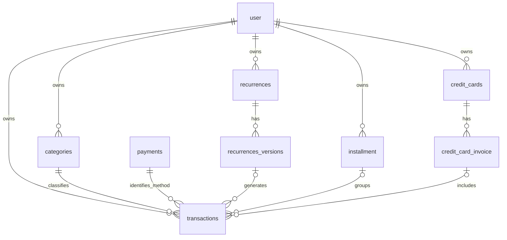

# Data model

This document records the goals, table responsibilities, and decisions for the first version. The implemented schema lives in [`src/main/db/schema.ts`](../src/main/db/schema.ts). Deferred work is tracked in [Future improvements](future-improvements.md).

## Main screen goal

The main screen presents a projected monthly balance and a timeline of financial
events. The summary includes unpaid invoices in their due month; it does not
represent confirmed available cash. A credit-card purchase remains in its
reference-date timeline month, independent of its invoice's due or payment month.

The first version uses these rules:

- Inflows are direct income entries. An explicit receipt date determines the
  month; without one, the reference date is treated as the receipt date.
- Outflows are direct expenses and invoices paid or due during the month. An explicit
  payment date determines the month; without one, direct expenses use the
  reference date.
- Unpaid invoices contribute in their due month. Paid invoices use the actual
  payment month instead, even when it differs from the due month.
- Monthly balance is inflows minus outflows; it is not an account balance.
- Credit-card purchases must not be counted again alongside their invoice total.

Category analysis should count purchases and installments without counting the invoice payment as another consumption expense.

## Core decisions

### Local profiles and initial catalogs

Profiles are local and open without authentication. Creating a profile stores
its name, email, and `pt-BR` or `en-US` locale. The active profile can change its locale through the profile menu; changes are validated and persisted before the interface updates. Existing or unsupported
preferences fall back to `pt-BR`. The historical password column is retained
for database compatibility; new profiles store a disabled marker, not credentials.
The active profile is held in the main process for the application session.
Restarting requires selecting a profile again; transaction operations require
an active profile and derive ownership from it rather than renderer input.

Default categories use the stable keys `food`, `housing`, `salary`, and `other`.
Categories remain owned by their profile. The shared payment catalog uses `pix`,
`debit`, `credit`, `cash`, and `bank_transfer`. Income accepts only `pix`, `cash`,
and `bank_transfer`; expenses accept only `pix`, `cash`, `debit`, and `credit`.
The form filters methods by transaction type and clears an incompatible selection
when the type changes. Main validates the same rule when creating entries or
changing their type. `pix_credit` remains deferred until its financial rules are defined.
Bank transfer is added idempotently when creating or entering a profile, including
existing profiles, without a schema migration or manual upgrade action.
Legacy methods retain their associations, and recognized legacy defaults acquire
catalog keys without replacing their identifiers or customized records.

Catalog display names are translated in the renderer. Customized category names
remain as entered. Retrying initialization preserves existing defaults, including
archived categories. Both supported locales use BRL without changing stored cents.
Monetary entry accepts digits and the profile's decimal separator, with up to two
decimal places; grouping separators and currency-prefixed paste are currently
rejected rather than reinterpreted. New credit expenses require a profile-owned
card and are associated with a suggested or explicitly chosen invoice. Selecting a
method does not set a payment date; settlement workflows remain deferred. Direct
income and expenses contribute to the summary on their reference date when no
explicit settlement date exists. This reporting fallback does not mark an entry
as settled; credit-method entries remain excluded from direct cash flow.

Creation and editing use separate dialogs. Editing changes only the description,
note, entry type, amount, and reference date. Main preserves category, payment
method, owner, and settlement date regardless of extra fields supplied through
IPC. This also allows editing entries with archived categories or legacy payment
methods without replacing their historical associations.
Changing the entry type requires the preserved payment method to support the new
type. The edit dialog offers compatible types only; editing other details of an
older entry preserves its method even if that combination is no longer available
for creation.

Leaving or activating a profile resets the renderer's financial state, transaction
draft, submission lock, and pending confirmation. Session changes invalidate
pending edit, catalog, locale, and financial-load responses. Older mutation
completions cannot clear a new draft, refresh another session, or show stale
notifications. Notification providers are recreated when the active profile changes.

Copying a transaction from its timeline action or context menu opens a creation
draft with its name, note, type, amount, reference date, category, payment method,
card, and invoice. It does not create an entry until the user saves. The draft
has no transaction identity, settlement date, or correction authorization and
uses the active profile when submitted. Current creation validation still applies,
including category and payment compatibility and credit-card correction previews.

### A transaction is one financial entry

`transactions` is the smallest financial unit in the domain: a purchase, salary, bonus, or individual installment. It does not represent every product on a receipt.

An installment purchase creates one transaction per installment. Shared purchase details live in `installment`. No additional transaction should store the full purchase amount because that would duplicate the value.

### Installments and invoices are different concepts

An installment group connects entries from the same purchase over time. An invoice groups card entries for a billing period.

| Example                   | `installment_id` | `credit_card_invoice_id` |
| ------------------------- | ---------------- | ------------------------ |
| One-time card purchase    | Empty            | Set                      |
| Card purchase installment | Set              | Set                      |
| Invoice-based installment | Set              | Empty                    |
| Salary or direct purchase | Empty            | Empty                    |

An `invoice_items` table is unnecessary because each installment is already a transaction. `transactions.credit_card_invoice_id` directly associates an entry with its invoice.

### Invoice payment

The first version pays an invoice in full through one event. `credit_card_invoice.paid_at` is empty while unpaid and stores the payment date after settlement. A date is required so cash flow can attribute the outflow to the correct month.

The payment does not create another expense transaction, and its date is not copied to every purchase on the invoice. Partial and multiple payments are outside the initial scope.

Cards configure a closing day, whether closing-day purchases are included, and
a positive number of calendar days after closing until the invoice is due.
Short months clamp the closing day without changing the recurring rule. Opening
follows the preceding period's last included purchase date. The due date is
closing plus the configured day offset, without weekend or holiday adjustment.
Each invoice preserves its concrete dates and applied closing-day policy.
Changing existing recurring card rules remains deferred; invoice-specific
corrections never change those general settings. Closing, due, and actual payment
dates remain separate. Invoice payment UI is tracked in TX-04.

## Table responsibilities

### `user`

Owns financial data and stores `id`, `name`, unique `email`, and `password`. Passwords must contain secure hashes; the schema does not implement authentication or hashing.

### `transactions`

Stores individual income and expense entries. Money uses integer cents. `reference_date` positions the entry in a reporting period, while `payment_date` records actual settlement for a direct entry. Optional foreign keys connect categories, recurrence versions, installments, and card invoices.

`note` is optional plain text. Blank or whitespace-only notes are stored as
`NULL`; nonempty notes have surrounding whitespace trimmed. Existing entries
remain without notes after migration. Editing may change or clear the note;
an update that omits the field preserves its existing value.

Installment group and number must be set together, the number must be positive, and `UNIQUE (installment_id, installment_number)` prevents duplicate positions. The application must still ensure the number does not exceed `installment.total_installments`.

### `installment`

Stores data shared by all installments: name, count, total amount, expected start and end dates, purchase date, and owner. Each installment is a separate transaction. Stored dates and totals must remain consistent with those transactions.

### `credit_cards` and `credit_card_invoice`

`credit_cards` identifies a profile-owned card and retains initial closing rules
and archival. Legacy cards have nullable rules rather than guessed settings;
their invoices remain accessible through manually supplied dates and membership.
Archived cards remain available for explicit historical entry and corrections.

Invoices belong to a card, with one invoice per card and closing date. They retain
opening, closing, due, and payment dates, an applied inclusion policy, and a
`total_source` of `calculated` or `statement`. Calculated totals are updated in
integer cents atomically with linked purchases. Statement totals preserve the
recorded amount while incomplete purchase details are entered; responses show
item totals and the difference separately. Legacy invoices migrate to statement
totals, preserving amounts and dates; unknown period metadata stays null.

Purchases retain their `reference_date`; invoice membership is persisted in
`credit_card_invoice_id` and is independent of the selected timeline month.
Changing a reference date preserves membership until the user explicitly
reassigns the purchase. Main validates ownership across cards, invoices, and
entries. Explicit out-of-period associations are displayed as manual overrides.

Financial corrections use a before/after preview and a state-derived token that
rejects stale proposals. Boundary corrections include affected adjacent periods
and purchases. A boundary correction is rejected if its resulting known period
overlaps another invoice after adjacent adjustments. Creation-only form
normalization runs only while the creation dialog is active, preserving legacy
card and invoice associations during editing.
The same database transaction saves entry changes, totals, and
`credit_card_history` snapshots. Historical paid invoices can be corrected
without changing their actual payment date. Adding missing details to a paid
statement invoice preserves its recorded cash outflow; changing its recorded
total deliberately refreshes the historical payment month. Corrections do not
copy payment dates onto purchases or create another expense transaction.

Card/invoice navigation has its own selected period and profile-session request
guards. The Cards section includes registration, archival, historical invoice
entry, unlinked-purchase association, total reconciliation, and correction history.

### `payments`

Defines payment methods by name and type. It does not represent invoice payment events. The current schema treats this as a shared catalog because it has no `user_id`.

### `categories`

Classifies entries and stores a display color. Categories belong to users. Invoice payments must not repeat the purchase categories as another expense.

`icon_key` stores a serializable icon identifier (for example, `food` or `salary`),
independent of the editable category name. Supported identifiers are defined by
`CategoryIconKey` in `src/shared/contracts/categories.ts`; Lucide components are
mapped only in `src/renderer/lib/category-icons.ts`. Unknown or missing identifiers
render the `other` icon. Transaction responses expose category details as
`category: { id, name, icon_key }`, with `category: null` for uncategorized entries.

The Drizzle schema gives new categories an `other` default. The prototype seed
assigns icons explicitly. Existing icons from the previous initializer are preserved.
Renaming a category does not change its stored icon. Category management has its
own tab, with profile-owned listing, creation, editing and archival through IPC.
The icon picker persists supported keys; main validates names, six-digit hex
colors, icons and compatibility before writing. Names are trimmed and limited to
100 characters. Descriptions are optional, limited to 500 characters, trimmed,
and stored as `NULL` when blank.

`transaction_type` is `income`, `expense` or `both`. Existing categories migrate
to `both` to preserve their previous use. Newly initialized salary categories
support income, food and housing support expenses, and other supports both.
New transactions require an active category compatible with their type; the
renderer and main enforce this. Historical transaction editing preserves the
original category even after archival or compatibility changes, without
revalidating or replacing that association. Category metadata edits apply to
existing entries because they retain the category ID.

Removal always archives the category, including unused categories. Archived
categories remain visible in management and readable through historical joins,
but disappear from new transaction options. Their names remain reserved. A
category edit never clears its catalog identity, so initialization does not
recreate an edited or archived default.

Names are unique per profile, including archived categories. Both application
validation and the SQLite expression index use `categoryNameKey`: trim, Unicode
NFC normalization and Unicode lowercase. Accents are preserved (`café` differs
from `cafe`), while accented case variants and canonically equivalent spellings
compare equally. The database connection registers the deterministic
`category_name_key` function before applying migrations.

### `recurrences` and `recurrences_versions`

`recurrences` preserves the continuous identity of a repeating commitment. `recurrences_versions` stores each rule version, including amount, frequency, interval, and validity dates. A recurring transaction points to the version that generated it so historical entries retain their original rule.

Frequency values are 1 daily, 2 weekly, 3 monthly, and 4 yearly. Versions of the same recurrence should not overlap. Changing or resuming a rule creates a new version; correcting one occurrence changes only its transaction.

## Recurrence generation

Occurrences should be generated on demand for the requested period:

1. Find versions whose validity intersects the period.
2. Calculate scheduled dates from the rule's base date, frequency, and interval.
3. Create only missing occurrences.
4. Load the timeline without overwriting existing manual changes.

Generation does not confirm payment. Direct entries keep `payment_date` empty until settlement, while card payment remains represented by the invoice.

A future `scheduled_date` field with `UNIQUE (recurrence_version_id, scheduled_date)` can provide stable occurrence identity. Skipped occurrences also need a persistent exception record so generation does not recreate them.

Open recurrence decisions include month-end dates, leap years, version calendar resets, overlap validation, defaults for generated transactions, and reconciliation after rule changes.

## Relationships

## Timeline and cash-flow example

A R$250 purchase made on August 20 appears in the August timeline. If its invoice
closes on August 31 and is due September 7, the summary projects R$250 in September
expenses while unpaid. If paid September 5, the outflow uses that day instead.
If paid October 2, it moves to October and is removed from September. The purchase
remains available through the invoice details and is not counted twice.

## Current conventions and limits

- Money is stored as integer cents to avoid floating-point errors.
- Dates use `YYYY-MM-DD`; SQLite's `DATE` declaration does not validate the format.
- Schema constraints and transaction operations are covered by SQLite integration tests.
- Schema changes use versioned Drizzle migrations; see [Database development](database-development.md).
- Cascade deletion behavior remains scheduled for review.
- The service creates calculated invoices atomically when linking purchases.
  Merely previewing a period does not create rows. Recurrence and installment
  generation remain deferred.

## Monthly projected summaries

The monthly statement API derives ownership from the active profile. Direct
entries with a direct payment method (`payments.type = 1`) contribute in their
`payment_date` month when it is present. Direct income and expenses
(`transactions.type = 1` or `2`) without a payment date contribute in their
`reference_date` month, so manually recorded receipts and PIX, cash, or debit
expenses appear immediately, including existing entries.
This fallback does not write a settlement date or change stored history. An
explicit payment date always takes precedence, preventing double counting.
Invoice-linked and credit-method entries are excluded from direct cash flow.
Paid invoices contribute their stored `amount_cents` in their `paid_at` month,
once, through the owning card. Unpaid invoices contribute that same total in their
`due_date` month, without marking them as paid. An explicit payment date replaces
the projected event, so early or late payments never count in both months.
Calculated invoices use their reconciled purchase total; statement invoices use
their recorded total even when purchase details are incomplete. Reference dates
also remain timeline dates. The UI calls this a projected monthly balance because
it includes commitments as well as recorded settlements.

One SQL query groups receipts, direct expenses, and paid or due invoices by their
effective cash-flow day. Totals are calculated in integer cents and converted to BRL units for the
DTO. The daily series includes every day of the selected month. Opening cash flow
is zero and closing cash flow equals income minus expenses; neither represents
an account balance. The savings rate is net divided by income, or zero when
there is no income. The event count includes direct receipts, direct
expenses, and paid or due invoices, rather than every purchase inside an invoice. Summaries are computed;
their reserved DTO identifier is zero.

Composite indexes support transaction lookups by profile and payment date, card
lookups by profile, and invoice lookups by card and payment date. Date predicates
use a half-open month range without applying functions to indexed columns.

The main process keeps up to 24 statements in an LRU memory cache keyed by profile
and month. Each request checks SQLite `total_changes()` for writes on its own
connection and `PRAGMA data_version` for commits on other connections, within
the same read transaction as aggregation. A changed revision clears the whole
cache, including after transaction edits, deletion, invoice changes, and external
writes. This conservative policy also invalidates on unrelated database writes.
Cache hits avoid aggregation but still perform the lightweight revision check.
Restarting discards the cache; no persistent aggregate table is maintained.
